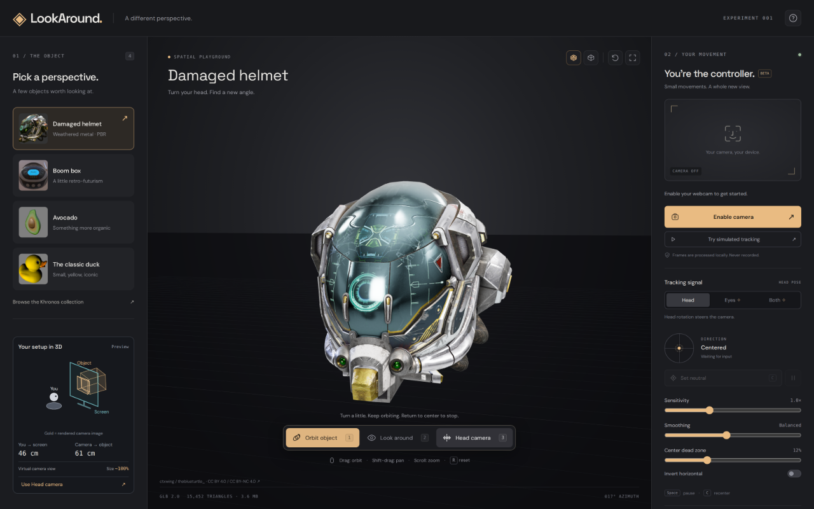
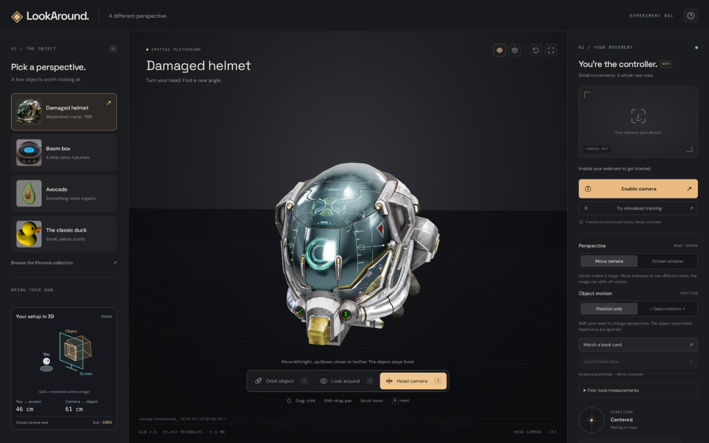

# LookAround

Move your head. Change your perspective.

A local 3D playground for GLB models, controlled by head position, head rotation,
or experimental eye direction. Explore a model with your webcam, use familiar
orbit/pan/zoom mouse controls, or try simulated tracking without a camera.
Built with TypeScript, Three.js, and MediaPipe; no account or native app required.

**[Open the live demo](https://lookaround.shaal.dev)** — use your webcam or try
simulated tracking.



The Damaged Helmet sample shown in screenshots and used as the social preview's
reference is by ctxwing / theblueturtle\_.
See [model credits and licenses](#sample-models-and-credits).



Head camera translates the view as you move left/right, up/down, or closer/farther.
Optional gaze rotation turns the object independently. Tracking markers are off
by default, and camera frames stay in your browser.

## Run

Requires Node 22.12 or newer and a modern browser with WebGL, Web Workers, and
camera support. Chrome or Edge on a desktop is the recommended starting point.

```sh
git clone https://github.com/shaal/LookAround.git
cd LookAround
npm install
npm run dev
```

Open **http://localhost:5174** in your regular browser. Installation downloads
four sample models, their credits, the face model, matching WASM, and GLB decoders.
Downloads are cached under ignored `public/` directories. `npm run setup` retries
asset preparation when needed. Runtime camera processing uses local assets.
Google Fonts is optional; system fonts are used if unavailable.

1. Choose a sample, drop a local `.glb`, or enter a direct, CORS-enabled model URL.
2. Click **Enable camera**, allow access, and look at the large dot in the middle
   of the screen. **Hold still for one second.** The red dot turns green and a
   ring fills while your head and eyes stay steady. Movement resets it. Completing
   the ring automatically sets head position, orientation, and eye direction.
3. Start with **Head** and **Orbit object**. Turn a little to orbit continuously;
   face neutral to stop. A modest held turn can make a complete 360° orbit.
4. Switch to **Look around** to keep the camera position fixed and turn its view
   left/right/up/down instead. Mode switching is explicit, via buttons or keys.
5. **Eyes** uses rough iris direction; **Both** adds a small eye-direction assist
   to head steering. These are experimental, not calibrated screen-gaze tracking.
   For eyes, hold your head still and look at the viewport center during capture.
6. **Head camera** (`3`) uses physical head **position**, including sideways,
   up/down, and closer/farther movement. **Move camera** is the default perspective:
   approaching enlarges the object, retreating makes it smaller, and moving right
   shifts its image left. The camera translates without automatically aiming back
   at the object, so it can move off-center or leave the viewport. Holding a head
   position holds the camera there. **Screen window** retains the earlier off-axis
   projection that keeps the monitor as a fixed window into the scene.
   **Position only** is the default: the object stays fixed, and only head
   translation changes the perspective. Head rotation and eye direction do not
   steer or rotate anything. **+ Gaze rotation** keeps the earlier experiment:
   eyes rotate the model around its center while head position moves the camera.
   Eye loss/blinking holds the model angle. Switching between these behaviors
   preserves the current view and model angle.
   Within **+ Gaze rotation**, choose **Follow gaze** for an angle that follows
   your eyes, or **Continuous** to keep turning while looking away from center.
   In Continuous, centering your eyes stops at the current angle immediately;
   it does not return to the original angle. Left/right and up/down gaze control
   rotation speed, with the existing gaze sensitivity and center dead zone.

### Simple physical setup

Head camera starts with the requested **32-inch 16:9 screen preset** (70.8 cm wide)
and approximately **46 cm eyes-to-screen distance** (1.5 feet). The initial object
distance is 61 cm, roughly two feet. These are estimates, not detected hardware.

- **Match a bank card:** hold a standard bank card against the display and resize
  the outline with its corner handle or slider. Click **Fits my card**. This gives
  physical screen scale without typing measurements; no card photo is taken.
- **Card beside face:** with the camera active, scan a standard bank-sized card
  held landscape. Follow three tilted holds: one edge, the opposite edge, then
  the top/bottom edge. The outline turns green and a progress line fills during
  each usable hold. Bring the card closer for these tilts if needed. Finally,
  face the camera and hold the card flat beside your eyes, at their depth.
  Review the approximate camera distance, then click **Use estimate**. Leave
  **My webcam is on this screen** checked only for a webcam mounted on the display.
  Put the card away and complete the normal reference dot. This learns a local
  face-pose scale and retains it through later reference captures. The face-only
  reference updates screen distance when the webcam checkbox is checked.
  If no outline appears, put the card in either dashed area beside your face,
  keep its long edges horizontal, and use a contrasting background. The scan
  reports face/card detection separately and explains placement, size, clipping,
  reflections and ambiguous rectangles. A red outline means the card was found;
  follow the tilt/size instruction until it turns green and the hold advances.
  Small hand tremor is filtered across a few frames. Brief outline misses pause
  the progress bar for up to 450 ms, with an amber outline, instead of restarting
  immediately. Larger movement or sustained loss starts a fresh hold. Blinking
  does not interrupt a card scan: iris tracking is only needed for the separate
  neutral/gaze capture afterward.
- **Fine-tune measurements** remains available. Measurements are saved locally.
  Card scale compensates for browser zoom changes; moving to a differently sized
  monitor requires another card match.

Card scanning is an experimental approximation, not a precision measurement.
It estimates a square-pixel pinhole lens with the principal point at image center
and no distortion. Three different tilts must agree; weak, clipped, missing,
unstable or inconsistent captures never replace the current setup. Detection
uses local OpenCV.js, loaded only when scanning. Face and card measurements come
from the same captured bitmap. The software checks edge support and corner-noise
sensitivity, but cannot verify the card's physical dimensions or that its surface
is actually level with the eyes. Lens distortion, webcam angle, autofocus, and
MediaPipe's canonical face origin still limit accuracy. The learned scale is
session-local; only an accepted screen-distance setting is saved. Cancel keeps
the previous calibration and requires no new camera permission.
The capture-only scan tolerates up to one second of processing delay and 750 ms
between paired frames, while requiring six distinct stable frames per hold.
Only accepted frames contribute to hold progress. Temporal filtering steadies
classification and the outline; lens fitting and final face-scale pairing still
use the original card/face measurements from each same captured frame.
Live head/eye steering retains its separate 250 ms freshness limit.

For a stationary-object test, choose **Position only** and a model without
animation. Head movement bypasses steering sensitivity, inversion, and normalized
deadzones. In Head camera those controls affect gaze only, and are disabled in
Position only. Camera translation and the screen projection update together in
physical units.
Move camera keeps its lens fixed under head movement; viewport resizing updates
the lens from the calibrated viewing-area dimensions. Switching perspective
preserves the applied camera position, reference, world scale, and object angle.
Away from neutral, changing perspective changes the image immediately, including
while paused. It does not recenter or start another reference capture.

**Your setup in 3D**, pinned beneath **Pick a perspective**, shows the applied
head position, viewing area, and a bounding box for the model. Gold lines on the
screen show the rendered image in the selected perspective. Move camera labels
the object's distance as virtual camera geometry and omits physical viewing
rays; Screen window shows the eye-to-object rays through the display.
The distances and approximate **Size** percentage
update in Head camera, including simulated input; paused or missing input holds
the last applied position. Other modes show a labelled setup preview.

With the defaults and an object centered ahead, Move camera gives about **120%**
image scale after a 10 cm approach, or **86%** after a 10 cm retreat. This is a
moving virtual camera rather than a physical window through the fixed monitor.
For comparison, Screen window places the object's center about **15 cm behind
the display** and gives about 94% on approach or 105% on retreat. That physical
window projection compensates for the screen filling more of your vision as you
approach it. The diagram's approximate size readout isolates head depth; gaze
rotation can also change the model's visible outline.

**Try simulated tracking** exercises the same input mapping and camera controls
without a camera, including the animated reference dot. It is visibly labelled and is
not a live tracking result.

**Tracking markers** are off by default; switch them on to inspect live input
after the reference hold. The white/cyan
three-axis cross shows head aim: translation moves it, rotation tilts its axes,
and approaching the screen enlarges it. The red circle combines head aim and
iris direction into a gaze estimate, not calibrated screen coordinates. Blinks
hide the circle; missing or stale head data hides both. Dashed markers indicate
an aim outside the window. Markers stay live while scene motion is paused or
mouse-controlled, independently of the selected steering mode and gaze rotation.

## Controls

| Control           | Effect                                                         |
| ----------------- | -------------------------------------------------------------- |
| `1` / `2` / `3`   | Orbit object / Look around / Head camera                       |
| `Space`           | Pause/resume scene movement                                    |
| `C`               | Reopen the center dot to set neutral, preserving the view      |
| `R`               | Reset and frame the current model                              |
| Left drag         | Orbit around the current focus, in every tracking mode        |
| Right drag        | Pan in screen space; Shift/Ctrl/Cmd + left drag also pans      |
| Scroll / middle drag | Zoom/dolly toward or away from the current focus            |
| Sensitivity       | How much a small head/eye movement changes the camera          |
| Smoothing         | Trade responsiveness for steadiness                            |
| Center dead zone  | Neutral region where tracking makes no movement                |
| Invert horizontal | Reverse horizontal steering for camera conventions/preferences |
| Tracking markers  | Show/hide the head cross and red gaze estimate                 |

Mouse navigation follows the [Three.js OrbitControls convention](https://threejs.org/docs/pages/OrbitControls.html)
in every mode, including both Head camera perspectives. Panning shifts the
camera and orbit focus together. Orbiting preserves an existing off-center aim;
starting a drag does not recenter the object. Zoom keeps the lens and orientation
unchanged. R resets the pan focus and frames the model. Mouse navigation temporarily
holds tracking and anchors the resulting view on release; scrolling keeps that
hold through a 200 ms quiet period. Overlapping scroll and drag gestures share
one hold, so tracking cannot resume midway through a drag. Trackpad pinch and
pixel-, line-, and page-based wheel deltas are normalized.

Camera loss or a sample older than 250 ms freezes movement immediately. Returning
after face loss reopens the center dot for another one-second hold. Hidden tabs stop sending
inference frames. Stopping the camera releases media tracks and terminates the
worker. Mouse dragging, mode switching, and pause/resume anchor the view without
silently replacing the reference chosen at the dot. Frames and landmarks are not
recorded, persisted, or uploaded.

Custom files must be binary `.glb`, preferably self-contained. Draco, Meshopt and
KTX2/Basis decoders are configured. Remote URLs must return a GLB and permit CORS;
download pages are not model URLs. Files over 150 MB are rejected. Animation clips
play automatically. A failed load preserves the previously visible model.

## Sample models and credits

The online source is the [Khronos glTF Sample Assets collection](https://github.khronos.org/glTF-Assets/),
pinned to commit `8f492390ddc7a2ae221a1369ef560589cf8c70fb`.
The app links to each downloaded model's complete upstream README.

| Model                                                                                               | Upstream credit and license                                                                                                                                       |
| --------------------------------------------------------------------------------------------------- | ----------------------------------------------------------------------------------------------------------------------------------------------------------------- |
| [Damaged Helmet](https://github.com/KhronosGroup/glTF-Sample-Assets/tree/main/Models/DamagedHelmet) | ctxwing, CC BY 4.0 conversion; earlier model by theblueturtle\_, CC BY-NC 4.0. Preserve both upstream notices; the earlier asset has a noncommercial restriction. |
| [Boom Box](https://github.com/KhronosGroup/glTF-Sample-Assets/tree/main/Models/BoomBox)             | Microsoft, CC0 1.0                                                                                                                                                |
| [Avocado](https://github.com/KhronosGroup/glTF-Sample-Assets/tree/main/Models/Avocado)              | Microsoft, CC0 1.0                                                                                                                                                |
| [Duck](https://github.com/KhronosGroup/glTF-Sample-Assets/tree/main/Models/Duck)                    | Sony, SCEA Shared Source License 1.0; full license is downloaded alongside its credits.                                                                           |

This project's MIT license covers its own code, not those separately licensed assets.
The pinned OpenCV.js package is Apache-2.0; setup copies its license beside the
local runtime at `/vision/opencv.LICENSE`.

## Deploy

The live demo is hosted on Cloudflare Workers at **https://lookaround.shaal.dev**.
With Wrangler signed into the Cloudflare account that owns `shaal.dev`, run:

```sh
npm run deploy
```

This builds the app and uploads `dist/`, including the sample models, decoders,
and local face-tracking assets. `wrangler.toml` configures the custom domain;
Cloudflare manages its DNS record and HTTPS certificate.

Social previews use static Open Graph and Twitter Card tags in `index.html`,
with a public PNG at `/social/lookaround-share-v1.png`. The artwork's generation
prompt is recorded in [docs/share-image-prompt.md](docs/share-image-prompt.md).

## Validation

```sh
npm test          # tracking math, camera movement, invalid/stale data, handoffs
npm run build    # strict TypeScript check and production bundle
npm run preview  # serve the production build on port 5174 (stop dev first)
```

Browser validation covered the four models, remote URL import, local file import,
the camera modes, simulation, pause, missing-camera handling, and responsive
layout. A portrait image supplied as a test video stream exercised the real
MediaPipe worker, reference capture, face loss/reacquisition, and camera teardown.
Timing tests check the one-second hold and resets for head/eye motion, blinks,
missing/stale frames, and slow drift. Other synthetic tests check that rotation alone
doesn't drive translation, held positions don't drift, and eye rotation doesn't
change the translation axes.
That verifies the software path, not live tracking comfort or accuracy. Default
physical direction, lighting/glasses performance, and eye control need a human
webcam trial. The horizontal inversion switch is available for that trial.

Projection tests verify fixed screen corners under XYZ motion, front/behind-plane
parallax, depth-dependent scaling, unchanged pose and projection on clutch rebases,
restoring the regular camera on mode exit, and resize without a fresh tracking frame.
Bank-card scale and zoom compensation are also checked. These numerical tests do
not establish real webcam depth accuracy or the user's actual card measurement.
Browser checks covered card resizing/confirmation, persistence across reload,
the distance-estimate flow, and a scaled portrait stream whose approach reduced
the reported viewing distance. Test calibration settings were cleared afterward.
Overview tests compare the diagram's screen image with the actual camera projection
in both perspectives under XYZ movement and a rotated screen frame, and check depth scale, held poses,
rebasing, and a preview that leaves the main camera unchanged. The diagram's SVG
was also rendered at closer, neutral, and farther positions for visual inspection.
Continuous gaze tests cover full revolutions, immediate neutral stopping with
smoothing, opposite directions, frame-rate independence, missing input, and
switching behaviors without changing the current angle.
Move-camera tests check growth and shrinkage in screen pixels, off-center and
offscreen translation, a fixed lens and orientation under head movement,
perspective switching without recapture, manual navigation, resize, invalid
tracking, and restoration of the regular camera on mode exit.
Card tests recover a known synthetic lens and distance, reject weak/inconsistent
views, exercise all four stable holds, and retain measured scale through a new
neutral. The real OpenCV runtime detects synthetic card images and rejects
clipped/face-overlapping rectangles. Worker tests check frame pairing, source-pixel
mapping, cancelled initialization, frame cleanup and continued face tracking after
a card error. The scan interface was inspected at desktop and phone widths using
a synthetic result. Physical card detection comfort and absolute webcam accuracy
still require a human trial; these tests do not establish either.
Browser troubleshooting also exercised all four holds with a synthetic moving
card and portrait through the actual MediaPipe/OpenCV worker, reaching an
approximate result of 51 cm for the fixture's 52 cm card depth. A missing-card
check verified the face/card labels and visible placement guides. This is software
validation, not a live-card accuracy measurement.
Additional hold regressions cover hand tremor, blinks, short pauses without
counting missing frames, sustained loss, unstable corners, real motion resets,
and small tilt changes around the acquisition threshold. Joint lens and
reprojection quality checks remain in force.

See [docs/research.md](docs/research.md) for sources and design decisions.

## Structure

```text
src/viewer.ts          GLB loading, lighting, animation, disposal, mouse controls
src/object-rotation.ts gaze-driven rotation of the centered model
src/camera-rig.ts      orbit / fixed-position look / head-position camera behavior
src/screen-window.ts   physically scaled XYZ view and fixed-plane off-axis projection
src/spatial-geometry.ts  screen-space physical geometry and projected model bounds
src/spatial-overview.ts  compact live 3D diagram of head, screen, and object
src/tracking-math.ts   pose, iris geometry, neutral, guards, signal filtering
src/reference-capture.ts  continuous one-second stability and reference capture
src/tracker.ts         opt-in camera and worker lifecycle, one frame in flight
src/card-calibration.ts  constrained multi-view card lens/scale estimation and holds
src/card-scan.ts       guided live card scan and result UI
src/main.ts            UI and input state, calibration, simulation
public/vision-worker.js  classic worker running local MediaPipe inference
public/card-detection.js  local OpenCV contours and straight-edge corner refinement
scripts/setup-assets.mjs  reproducible downloads and decoder preparation
```
